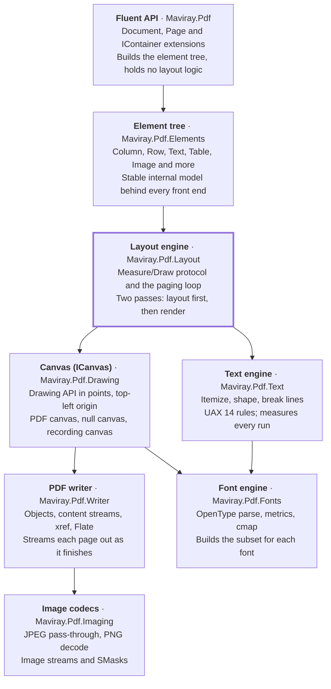
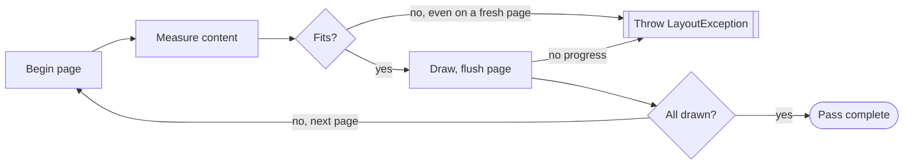

# Maviray.Pdf — Fully Managed .NET PDF Generation Library

**Design Document · Draft v0.2** · Nov 19, 2026 · Yan Doldonov

## Summary

Maviray.Pdf is a fully managed .NET library that generates PDF documents from C# code through a fluent layout API, in the spirit of QuestPDF. Every layer is written in C#: PDF writer, font parser and subsetter, text layout, image handling and layout engine. It has no native dependencies.

Why fully managed:

- **Runs everywhere .NET runs.** One package covers Windows, Linux and macOS on x64 and ARM64, containers, Azure App Service and Functions, Blazor WebAssembly and Native AOT.
- **Nothing native to ship or patch.** QuestPDF, for comparison, depends on a custom native Skia build per platform.
- **Full control of the output.** File size, determinism, PDF/A and tagged PDF are decided by our own writer, not by a rendering backend.
- **Own IP.** The library can be licensed, sold or open-sourced on any terms.

The trade-off is that we own the hard parts that Skia and HarfBuzz would otherwise provide: font subsetting, text shaping and line breaking. Scope control is therefore the main risk, and the roadmap is built around it.

This is draft v0.2. It records four decisions taken since v0.1: the name Maviray.Pdf, a revenue-gated licence, a public source repository, and net10.0 as the only target framework. It is the input for the functional specification and, later, the implementation plan. Decisions still open are collected under Open questions.

## Goals and non-goals

Version 1 targets data-driven business documents in European languages: invoices, reports, contracts, certificates and policy summaries.

**Goals**

1. **Code-first documents.** Documents are composed in C# from data, with reusable components and no templates or markup.
2. **Predictable layout with automatic paging.** Content flows across pages. Headers, footers, page numbers and repeated table headers work without manual breaks.
3. **Correct Unicode text.** Embedded, subsetted fonts cover Latin (including German, Turkish and Azerbaijani), Cyrillic and Greek. Copy, paste and search work in every viewer.
4. **Zero native dependencies.** The library is safe for trimming and Native AOT and runs in Blazor WebAssembly.
5. **Small, standards-conformant output.** Files pass qpdf structure checks, and PDF/A output passes veraPDF.
6. **Fast enough for server batch jobs.** Memory is bounded by the page being written, not by the document. Concrete targets are set after the first benchmark.
7. **Ready for accessibility.** The element tree is designed so tagged PDF (PDF/UA) can be added without breaking the API.

**Non-goals for v1**

- HTML or CSS to PDF conversion.
- Reading, editing, merging or splitting existing PDFs. That is a separate parser product.
- Rendering PDFs to images, or a viewer.
- Complex-script shaping (Arabic, Hebrew right-to-left, Indic). The text pipeline leaves room for it, but it is not built in v1.
- AcroForm fields, form filling and digital signatures.
- A visual (WYSIWYG) designer.

## Requirements

There are 35 starting requirements, each with an ID that the spec and the tests can trace, a priority, and the roadmap phase that delivers it. Phases are defined in the Roadmap section.

**Functional**

| ID | Requirement | Priority | Phase |
| --- | --- | --- | --- |
| FR-01 | Fluent C# API that builds a document, its pages and an element tree | Must | P1 |
| FR-02 | Page settings: standard and custom sizes, orientation, margins, page background | Must | P1 |
| FR-03 | Header, content and footer slots; header and footer repeat on every page | Must | P1 |
| FR-04 | Automatic paging: any element tree flows across as many pages as needed | Must | P1 |
| FR-05 | Current page number and total page count inside text | Must | P1 |
| FR-06 | Containers: Column, Row (fixed, relative and auto widths), Padding, Align, Width/Height constraints, Background, Border, Layers | Must | P1 |
| FR-07 | Rich text spans: family, size, weight, italic, colour, underline, strikethrough, letter spacing, line height; left, center, right and justified alignment | Must | P1 (justify P2) |
| FR-08 | Embedded, subsetted TrueType (glyf) fonts with a ToUnicode map | Must | P1 |
| FR-09 | Clear layout errors: content that can never fit throws an exception naming the element path | Must | P1 |
| FR-10 | Document metadata: title, author, subject, keywords, language, creation date | Must | P1 |
| FR-11 | Table: column definitions, repeated header and footer rows, row and column spans, rows that split across pages | Must | P2 |
| FR-12 | Images: JPEG and PNG including transparency; fit modes; one embedded copy per distinct image | Must | P2 |
| FR-13 | Flow controls: ShowEntire, EnsureSpace, PageBreak, ShowOnce, SkipOnce, ShowIf on page conditions | Should | P2 |
| FR-14 | Reusable components and per-page dynamic components | Should | P2 |
| FR-15 | Font fallback per character across an ordered family list | Should | P2 |
| FR-16 | Vector drawing: lines, rectangles, rounded corners, paths, dashes, opacity, clipping; a custom canvas element | Should | P2 |
| FR-17 | Kerning and standard ligatures (OpenType GPOS and GSUB) | Should | P3 |
| FR-18 | Hyphenation for German, English, Russian and Turkish | Should | P3 |
| FR-19 | Hyperlinks (external and internal), bookmarks, table of contents with page numbers | Should | P3 |
| FR-20 | OpenType CFF (.otf) fonts | Should | P3 |
| FR-21 | PDF/A-2b and PDF/A-3b, including embedded files such as ZUGFeRD or Factur-X invoice XML | Should | P4 |
| FR-22 | Tagged PDF and PDF/UA conformance | Could | P5 |
| FR-23 | Encryption and permissions (AES-256) | Could | P5 |
| FR-24 | SVG subset | Could | P5 |
| FR-25 | Right-to-left text and complex-script shaping | Could | P5 |

**Non-functional**

| ID | Requirement | Priority | Phase |
| --- | --- | --- | --- |
| NFR-01 | Pure managed code: no native libraries, no P/Invoke | Must | P0 |
| NFR-02 | Safe for trimming and Native AOT: no runtime reflection or dynamic code generation | Must | P0 |
| NFR-03 | Targets net10.0, the current long-term support release | Must | P0 |
| NFR-04 | Independent documents can be generated concurrently; loaded fonts are shared read-only | Must | P1 |
| NFR-05 | Memory bounded by the current page: each page is flushed to the output stream when finished | Must | P1 |
| NFR-06 | Output renders correctly in Acrobat, Chrome (PDFium), Firefox (pdf.js), macOS Preview and poppler | Must | P1 |
| NFR-07 | Deterministic mode: the same input and settings produce byte-identical files | Should | P1 |
| NFR-08 | Performance targets per benchmark scenario, fixed after the P1 baseline | Should | P3 |
| NFR-09 | Public API fully covered by XML docs; semantic versioning from 1.0 | Must | P2 |
| NFR-10 | Font and image parsers are fuzz-tested, because they read untrusted input | Must | P2 |

## Architecture

The library is one assembly, `Maviray.Pdf`, organised as five layers and three shared services, each in its own namespace. Dependencies point only downward, so each layer can be tested on its own: the layout engine against a recording canvas, the writer without any layout.



Arrows run from caller to callee. The canvas is the seam between layout and output: the null canvas serves the layout pass, the recording canvas serves tests, and the PDF canvas produces the file.

## Public API design

The public API is a thin fluent layer that builds an element tree. The layout engine never sees the fluent descriptors, only the tree. This keeps the API free to evolve, and it lets other front ends (JSON templates, a designer) produce the same tree later.

```csharp
FontRegistry.Default.Register("Inter", File.OpenRead("Inter-Regular.ttf"));
FontRegistry.Default.Register("Inter", File.OpenRead("Inter-Bold.ttf"), FontWeight.Bold);

Document.Create(doc =>
{
    doc.Metadata(m => m.Title("Rechnung 2026-0042").Language("de-DE"));

    doc.Page(page =>
    {
        page.Size(PageSizes.A4);
        page.Margin(20, Unit.Millimetre);
        page.DefaultTextStyle(t => t.FontFamily("Inter").FontSize(10));

        page.Header().Row(row =>
        {
            row.RelativeItem().Text("Rechnung").FontSize(20).Bold();
            row.ConstantItem(120).Image(logoBytes);
        });

        page.Content().PaddingVertical(12).Column(col =>
        {
            col.Spacing(8);
            col.Item().Text(customer.Name).Bold();
            col.Item().Table(table =>
            {
                table.Columns(c => { c.Relative(3); c.Constant(80); });
                table.Header(h => { h.Cell().Text("Position"); h.Cell().AlignRight().Text("Betrag"); });
                foreach (var line in invoice.Lines)
                {
                    table.Cell().Text(line.Description);
                    table.Cell().AlignRight().Text(line.Amount.ToString("C"));
                }
            });
        });

        page.Footer().AlignCenter().Text(t =>
        {
            t.Span("Seite "); t.CurrentPageNumber(); t.Span(" von "); t.TotalPages();
        });
    });
}).GeneratePdf(outputStream);
```

**API principles**

- **Containers chain.** Every modifier is an extension method on `IContainer`. It wraps the child slot and returns the inner `IContainer`, so `.Padding(10).Background(c).Text(...)` reads outside-in.
- **One child per container, many per layout element.** Column, Row, Table and Layers take a descriptor callback; everything else wraps one child.
- **Text has its own descriptor.** `Text(...)` returns a span descriptor for style chaining. `Text(t => ...)` builds rich text from spans, page numbers and links.
- **Components.** `IComponent.Compose(IContainer)` packages reusable blocks such as an address box or a totals table. Dynamic components are called again on every page.
- **Units.** Points (1/72 inch) internally; helpers accept millimetres, centimetres and inches.
- **Colours.** A `Color` struct for RGB with hex parsing; CMYK is added with PDF/A and print profiles.
- **Settings.** Document-level options: PDF version, conformance level, compression level, deterministic mode, layout diagnostics.
- **Output.** `GeneratePdf(Stream)`, `GeneratePdf(string path)` and `byte[] GeneratePdf()`. Generation is synchronous and CPU-bound. An async overload only wraps stream writes.
- **Errors.** Content that can never fit throws `LayoutException` with the element path, for example `Page 3 > Content > Column[2] > Table > Row 14`.

The API shape deliberately resembles QuestPDF so users can migrate easily. The implementation must be clean-room (see Packaging and licensing).

## Layout engine

The layout engine runs a two-phase protocol. Each element is first measured against the space available, then drawn. Measuring reports whether the element fits fully, fits partly, or does not fit at all. Paging, splitting and keep-together rules all follow from that single contract.

```csharp
public enum SpacePlanKind { Wrap, PartialRender, FullRender }

public readonly record struct SpacePlan(SpacePlanKind Kind, float Width, float Height);

public abstract class Element
{
    // Pure: may run many times per page and must not change state.
    public abstract SpacePlan Measure(Size available, LayoutContext context);

    // Commits: draws what fits and advances the element's cursor.
    public abstract void Draw(Size available, DrawContext context);

    // Restores the initial state before a new generation pass.
    public virtual void ResetState() { }

    public virtual IReadOnlyList<Element> Children => [];
}
```

**Contract**

- **FullRender:** everything remaining fits in the returned width and height.
- **PartialRender:** part fits. `Draw` renders that part, and the rest continues on the next page.
- **Wrap:** nothing fits here, so the parent moves the element to the next page.
- `Measure` has no side effects and gives the same answer for the same state and size. That is what makes caching safe.
- A returned size never exceeds the available size.
- After a PartialRender, `Draw` must consume at least one unit (a line, a row, a child). Otherwise the engine stops with a no-progress error rather than looping forever.

**Generation passes**

1. **Layout pass.** Runs the paging loop against a null canvas. It counts pages and records the positions of named sections for total pages, tables of contents and internal links. No text encoding or image work is done.
2. **Reset.** Calls `ResetState` on the whole tree.
3. **Render pass.** Runs the loop again against the PDF canvas, with page totals and positions now known.

If the tree uses no total-pages span, table of contents or forward link, the layout pass is skipped.



A page that ends with a partial fit loops back for the next page. Content that cannot fit even on an empty page, or a draw that consumes nothing, stops the pass with a `LayoutException`.

**Page structure.** The page element measures the header and footer first. Both must fit fully on every page, and both are reset after each page so they repeat. The content slot gets the height that remains. The footer is drawn against the bottom margin.

**Element catalog**

| Element | Role | Across pages | Phase |
| --- | --- | --- | --- |
| Column | Stacks children vertically with spacing | Splits between and inside children | P1 |
| Row | Places children side by side with fixed, relative or auto widths | Each cell continues on its own | P1 |
| Padding, Align, Width, Height, Min/MaxHeight | Constrain or position one child | Follows the child | P1 |
| Background, Border | Decorate the space given to the child | Drawn on every page part | P1 |
| Text | Rich text paragraph | Splits by line | P1 |
| Line | Horizontal or vertical rule | Never splits | P1 |
| PageBreak | Forces the rest onto a new page | Forces a split | P1 |
| Table | Grid with header and footer rows and spans | Splits by row; tall rows split inside | P2 |
| Image | Raster image with a fit mode | Never splits; moves to the next page | P2 |
| Layers | Stacks children in z-order (watermarks, backgrounds) | Primary layer drives paging | P2 |
| ShowEntire, EnsureSpace | Keep content together, or require minimum space | Turns a partial fit into Wrap | P2 |
| ShowOnce, SkipOnce, ShowIf | Page-conditional visibility | Follows the child | P2 |
| Canvas | User-drawn vector content of a fixed size | Never splits | P2 |
| Section, Hyperlink | Named location for links and contents; clickable area | Follows the child | P3 |

**Key algorithms**

- **Column** measures children from its cursor, adds their heights, and stops at the first partial fit or Wrap. Spacing is added only between items on the same page. It returns Wrap only when its first remaining child wraps.
- **Row** resolves widths in order: constant, then auto (the child measured at unlimited width), then relative shares of the rest. Its height is the tallest unfinished cell. If any cell wraps, the whole row wraps. A cell that finished on an earlier page draws nothing on later pages.
- **Text** lays out lines once per width and caches them. Measuring counts how many lines from the cursor fit; zero lines means Wrap.
- **Impossible content.** An element that wraps on a fresh, empty page can never fit, so the engine throws `LayoutException`. ShowEntire on content taller than a page falls back to splitting and logs a warning.

**Caching and diagnostics.** Measure results are cached per element by available size and state version, and `Draw` invalidates them. A debug mode draws element bounds and names on the page. Every layout exception reports the element path, the available size and the requested size.

## Text and typography

Text is the largest engineering cost in a fully managed library, so v1 limits itself to scripts that need no contextual shaping: Latin, Cyrillic and Greek. The pipeline has separate stages so that kerning, ligatures and complex scripts can be added later without changing the layout engine.

**Pipeline**

1. **Normalize.** Input strings are normalized to NFC and split into grapheme clusters (`StringInfo`, `Rune`), so a cluster is never broken.
2. **Itemize.** Spans are cut into runs that share one style, one font (after fallback), one script and one direction.
3. **Shape.** Each run maps code points to glyph IDs and advances.
    - v1: `cmap` lookup plus `hmtx` advances.
    - P3: pair kerning from GPOS (or the legacy `kern` table) and standard ligatures from GSUB.
    - P5: contextual shaping for Arabic and Hebrew behind the same `IShaper` interface.
4. **Break lines.** Break opportunities follow Unicode UAX #14 (line breaking). v1 uses greedy filling; hyphenation (Liang patterns) arrives in P3. Optimal Knuth–Plass breaking is a later option.
5. **Lay out lines.** Alignment, letter spacing, baseline and line height from `hhea`/`OS/2` metrics. Justification positions each word explicitly, because the PDF word-spacing operator (`Tw`) does not work with two-byte glyph encodings.
6. **Page.** Lines are the unit of splitting across pages; widow and orphan control comes with P2.

**Fonts**

- **Registration only.** Fonts are registered from a stream, byte array or file path. The core never scans system fonts; that is a separate optional package. This is what keeps behaviour identical on servers, containers and WebAssembly.
- **Matching.** Family, weight (100 to 900) and style, resolved to the nearest available face with CSS-style weight matching. Synthetic bold and italic are a fallback that logs a warning.
- **Fallback.** A style can name an ordered list of families, and each grapheme falls back to the first family that covers it. A glyph no font covers renders as `.notdef` and raises a diagnostic event.
- **Parsed once.** A loaded font is immutable and shared across documents and threads. Subset state belongs to each document.
- **Not in v1:** variable-font instancing, TrueType Collections (`.ttc`) and colour fonts. Each throws a clear `NotSupportedException`.

## Font subsetting and embedding

Every font is embedded as a subset containing only the glyphs the document uses, in a Type 0 font with Identity-H encoding. This is what makes any Unicode character printable and searchable, and it keeps files small.

**Glyph IDs are assigned on first use.** When the PDF canvas first draws a glyph, it gets the next subset glyph ID (0 is reserved for `.notdef`). Content streams are written with those IDs immediately. The subset font is built once at the end, in the same order, so nothing has to be renumbered or rewritten.

**TrueType subset build (P1)**

1. **Closure.** Composite glyphs (`numberOfContours < 0`) pull in their component glyphs, which are appended to the subset.
2. **Rebuild `glyf` and `loca`.** Original glyph data is copied, component indices are remapped to subset IDs, and `loca` uses the long format.
3. **Rebuild metrics.** `hmtx`, `hhea.numberOfHMetrics` and `maxp.numGlyphs` are rewritten for the subset.
4. **Fix `head`.** Set `indexToLocFormat`, recompute table checksums and `checkSumAdjustment`.
5. **Keep hinting.** Copy `cvt `, `fpgm` and `prep` unchanged, write `post` as format 3, and drop `cmap`, `kern`, GPOS and GSUB, which the PDF does not need.

**PDF objects per font**

| Object | Key entries | Purpose |
| --- | --- | --- |
| Type 0 font | `/Encoding /Identity-H`, `/DescendantFonts`, `/ToUnicode` | The font the page resources reference |
| CIDFontType2 | `/CIDToGIDMap /Identity`, `/W` widths in compact ranges | Glyph widths for the viewer |
| FontDescriptor | `/Flags`, `/FontBBox`, `/Ascent`, `/Descent`, `/CapHeight`, `/ItalicAngle`, `/StemV` | Metrics a viewer uses when substituting |
| FontFile2 stream | Flate-compressed subset, `/Length1` | The embedded font program |
| ToUnicode CMap | `bfchar`/`bfrange` from glyph ID to UTF-16 | Copy, paste, search and screen readers; a ligature maps to several characters |

**Rules**

- **Subset tag.** The font name is six capital letters, a plus sign and the PostScript name. The tag is derived from a hash of the glyph set, so deterministic mode stays byte-identical.
- **Embedding rights.** `OS/2.fsType` is honoured: restricted-licence fonts are refused, and "no subsetting" fonts are embedded whole.
- **CFF fonts (P3).** OpenType fonts with CFF outlines become CIDFontType0 with a `FontFile3` stream. A first version may embed the whole CFF table; CharString and subroutine subsetting follows.

## PDF writer

The writer streams. Each indirect object goes to the output as soon as it is complete, and only its byte offset is kept for the cross-reference table. A finished page is flushed immediately, so memory stays bounded by one page plus shared resources.

**Object model.** `PdfNull`, `PdfBoolean`, `PdfInteger`, `PdfReal`, `PdfName`, `PdfString` (literal, hex, UTF-16BE text), `PdfArray`, `PdfDictionary`, `PdfStream` and `PdfReference`. Serialization writes directly into a buffered output with no intermediate strings.

**Write order**

1. Header (`%PDF-1.7` plus a binary comment line).
2. Per page: the content stream, then the page dictionary with a reference to the page tree, reserved up front.
3. Shared resources written once at the end: subset fonts, images on first use, graphics states.
4. Page tree (balanced for large documents), catalog, info dictionary and XMP metadata.
5. Cross-reference table and trailer with `/ID`.

**Content streams.** A typed builder emits operators (`q`/`Q`, `cm`, `re`, `f`, `S`, `BT`/`ET`, `Tf`, `Tm`, `TJ`, `Do`, `gs`). It tracks graphics and text state, so redundant colour, font and line-width changes are skipped. Numbers use the invariant culture, at most four decimals and no exponent form.

**Coordinates.** The layout engine works in points with a top-left origin. The PDF canvas converts to PDF's bottom-left origin at the point of drawing, so element code never deals with flipped axes.

**Compression.** Content streams and font programs use FlateDecode through `System.IO.Compression.ZLibStream`, at a configurable level. JPEG images keep their own encoding.

**Versions and structure options**

- PDF 1.7 by default; PDF 2.0 as an opt-in.
- A classic cross-reference table in v1. Cross-reference streams and object streams come in P4, and typically shrink files with many small objects.
- Images are de-duplicated by content hash, and fonts are shared across pages.
- The document ID is random by default and derived from a content hash in deterministic mode.

## Images and vector graphics

Images are passed through in their original encoding wherever PDF allows it. Decoding happens only when it cannot be avoided, which keeps generation fast and avoids quality loss.

| Input | Handling in the PDF | Phase |
| --- | --- | --- |
| JPEG (grey, RGB, CMYK) | Embedded unchanged as DCTDecode; size and components read from the SOF marker; Adobe-inverted CMYK gets a `/Decode` array; EXIF orientation applied as a transform | P2 |
| PNG, no transparency (grey, RGB, palette) | IDAT data embedded as-is with FlateDecode and the PNG predictor (`/Predictor 15`); palettes become an `/Indexed` colour space | P2 |
| PNG with an alpha channel or `tRNS` | Decoded, then split into a colour image and an `/SMask` alpha image, both Flate-compressed | P2 |
| PNG, 16-bit or interlaced | 16-bit kept at 16 bits per component; Adam7 interlacing decoded fully | P2 |
| Embedded ICC profile | Written as an ICCBased colour space; needed for PDF/A | P4 |
| BMP, GIF, WebP, TIFF | Optional decoder packages, not in the core | Later |

**Image options.** Fit modes are FitWidth, FitHeight, FitArea and Stretch. An optional target DPI for downsampling large photos needs a managed JPEG encoder, so it is deferred.

**Vector drawing (P2).** The canvas API covers lines, rectangles, rounded rectangles, ellipses and arcs (converted to Bezier curves), and arbitrary paths. It also supports fill and stroke, dashes, caps and joins, opacity through ExtGState, and clipping. Users get it through a `Canvas` element with a fixed size. Gradients (axial and radial shadings) come later.

**SVG (P5).** A subset renderer is planned: paths, basic shapes, transforms, groups, fill and stroke. Text in SVG is out of scope at first.

## Document features and conformance

Navigation features build on the layout pass, which already knows where every named section lands. The conformance profiles mostly constrain what the writer may emit, so they are writer settings, not new elements.

| Feature | How the PDF carries it | Phase |
| --- | --- | --- |
| Metadata | Info dictionary in P1; XMP metadata stream and `/Lang` in P4 | P1, P4 |
| External hyperlinks | Link annotations with a URI action over the element's area | P3 |
| Internal links | Named destinations created from Section elements | P3 |
| Bookmarks | `/Outlines` tree built from sections and headings | P3 |
| Table of contents | Page numbers taken from the layout pass | P3 |
| PDF/A-2b | All fonts embedded (already true), XMP, sRGB OutputIntent with ICC profile, no encryption, document ID | P4 |
| PDF/A-3b and attachments | Embedded files with `/AFRelationship`, e.g. ZUGFeRD or Factur-X e-invoice XML | P4 |
| Tagged PDF and PDF/UA | Structure tree with marked content (`BDC`/`EMC`), role mapping, alt text, reading order; elements map to Heading, Paragraph, Table and Figure | P5 |
| Encryption | AES-256 (revision 6) with user and owner passwords and permissions | P5 |
| Digital signatures | Not planned for v1; reserving signature byte ranges is a later option | Later |

Accessibility is designed in from P1 even though it ships in P5. Elements keep a semantic role (heading level, paragraph, table cell, figure with alt text), and the canvas can wrap drawing in marked-content sequences. Adding PDF/UA later then needs no API break, which matters for consumer-facing documents under the European Accessibility Act.

## Performance, memory and threading

One document is generated on one thread, and many documents can be generated in parallel. Throughput on servers therefore comes from concurrency across documents, not from parallel layout inside one document.

**Memory**

- The streaming writer flushes each page, so peak memory is roughly the largest page plus fonts and unique images.
- Parsers use `Span<T>` and `ReadOnlyMemory<T>` over the original font bytes. Buffers come from `ArrayPool<T>`.
- Hot paths (measure, text layout, content-stream writing) avoid LINQ, boxing and per-glyph allocations.

**CPU**

- Measure results and text line layouts are cached (see Layout engine).
- The layout pass skips glyph encoding and image work. When no total-pages span, table of contents or forward link is used, it is skipped entirely.
- Flate compression of finished pages can run on a background worker while layout continues. This is optional and only applies to large documents.

**Threading**

- `FontRegistry` and loaded fonts are immutable after registration and safe to share.
- Per-document state (subset builders, image cache, writer) is never shared.
- No static mutable state outside the registry.

**Benchmarks (BenchmarkDotNet).** Four scenarios set the targets after the P1 baseline:

1. A one-page invoice.
2. A 100-page text report with headers, footers and page totals.
3. A table of 5,000 rows across pages.
4. An image-heavy catalogue of 50 pages.

QuestPDF and PDFsharp/MigraDoc on the same scenarios serve as reference points, measuring time, allocations and file size.

## Testing and validation

Every layer is tested on its own, and every generated file is checked by tools we did not write. A PDF that only opens in our own tests proves nothing; it has to pass independent validators and render the same in several viewers.

| Layer | What is checked | How |
| --- | --- | --- |
| PDF objects and writer | Serialization, offsets, xref correctness | Unit tests; `qpdf --check` on every generated file in CI |
| Font parser | Tables, cmap formats 4 and 12, metrics | Unit tests against a corpus of open fonts (Noto, DejaVu, Inter, Roboto) |
| Font subsetter | Subset loads and matches original glyph outlines | Re-parse with our parser and with fontTools (`ttx`) in CI |
| Layout engine | Positions and sizes of every element | A recording canvas captures draw calls; assertions run without any PDF |
| Whole documents | No unintended change in output | Deterministic mode plus snapshot tests (Verify) on the PDF bytes |
| Rendering | Same look across viewers | Pages rasterized with pdftoppm and PDFium, compared to approved PNGs |
| Text extraction | ToUnicode correctness for German, Turkish, Cyrillic, Greek | `pdftotext` output compared to the source strings |
| Conformance | PDF/A and PDF/UA rules | veraPDF in CI from P4 |
| Untrusted input | Font and image parsers do not crash or hang | Fuzzing with SharpFuzz, then corpus regression |
| Platforms | Same output everywhere | CI matrix: Windows, Linux, macOS; x64 and ARM64; Native AOT publish; Blazor WebAssembly smoke test |

A manual check on every release covers the viewers that cannot run in CI: Adobe Acrobat and macOS Preview.

## Packaging, platforms and licensing

Maviray.Pdf ships as one core NuGet package with no runtime dependencies. Optional features go in add-on packages so the core stays small and AOT-friendly.

**Packages**

- `Maviray.Pdf`: API, layout, text, fonts, images, PDF writer.
- `Maviray.Pdf.Fonts.System`: optional discovery of installed system fonts, for desktop and server only.
- `Maviray.Pdf.Fonts.Default`: optional bundled open-licence font (OFL), so a first document works with zero setup.
- Later: `Maviray.Pdf.Svg`, extra image decoders, and a previewer tool with hot reload.

**Publishing.** CI publishes packages to GitHub Packages, in the Maviray organisation's feed, the same as Maviray's other libraries. nuget.org isn't used for now (see Open questions). A merge into `main` publishes a release; a repository admin can publish a pre-release from any branch. Versions follow Semantic Versioning, calculated from git history. [Versions and packages](../versions-and-packages.md) has the details.

**Naming.** Every project, package and namespace sits under `Maviray.Pdf`. The core project is `Maviray.Pdf`, and every other project is `Maviray.Pdf.<Name>`, including tests and benchmarks (for example `Maviray.Pdf.Tests`). Inside the core, each layer has its own namespace (see Architecture).

**Platforms.** The target is net10.0, the current long-term support release. .NET 8 reached end of support on 10 November 2026, and .NET Framework 4.8 (netstandard2.0) is not supported. The core uses no platform APIs beyond the base class library, so every OS, architecture, Native AOT and WebAssembly work by construction.

**Licensing model**

The decision is a revenue-gated licence: free below an annual revenue threshold, and a paid commercial licence above it. The table records the options that were considered.

| Model | Example in the market | Effect |
| --- | --- | --- |
| MIT or Apache 2.0 | PDFsharp | Widest adoption; no direct revenue |
| AGPL plus commercial licence | iText | Free for open source; companies buy to avoid AGPL obligations |
| Free under a revenue threshold, paid above it | QuestPDF | Free for small users; enterprises pay |
| Commercial only | Most component vendors | Revenue from day one; hardest adoption |

The terms are in `LICENSE` (Maviray.Pdf Licence 1.0):

- **Free use.** Organisations with annual gross revenue below EUR 1,000,000, individuals for personal non-commercial use, registered charities and non-profits, and a 30-day evaluation outside production.
- **Commercial licence.** Everyone else. An organisation that crosses the threshold has 90 days after that financial year to switch.
- **Protections.** The library can't be resold or repackaged as a PDF library or hosted PDF-generation service. Only Maviray may publish its source outside GitHub forks.
- **Generated documents.** These carry no restrictions.

Version 1.0 was written without legal review. Each release ships with the licence version it was published under, so a reviewed version can replace 1.0 for later releases.

**Source availability.** The repository is public on GitHub, and the source is available under the Maviray.Pdf Licence, which is not an open-source licence:

- Anyone can read the source and fork it on GitHub. Only Maviray may publish it anywhere else.
- Issues and pull requests from outside contributors are welcome. By contributing, contributors let Maviray use their work under any licence, including commercial ones (licence section 10).
- Every merge into `develop` or `main` needs the maintainer's approval.

Internal engineering material is kept in private repositories and is never committed here.

**Clean-room rule.** QuestPDF's Community License (version 3.0, effective 6 July 2026) is source-available, not open source, and does not grant MIT terms ([source](https://www.questpdf.com/license/community.html)). Maviray.Pdf takes inspiration from its public API and documentation only. Nobody working on Maviray.Pdf reads or ports QuestPDF source code, and design decisions are recorded independently, starting with this document. The licence text is written independently too, not adapted from QuestPDF's.

**Font licences.** Users are responsible for the embedding rights of the fonts they register. The library enforces `OS/2.fsType` (see Font subsetting and embedding).

## Risks and mitigations

Scope is the biggest risk. Each phase therefore ends in a working, usable library, and the roadmap gates keep later features from leaking into earlier phases.

| Risk | Impact | Mitigation |
| --- | --- | --- |
| Feature creep towards full QuestPDF parity | High | v1 is defined by one real document (see Open questions); phase gates; non-goals list |
| Solo side project stalls before it is useful | High | P1 is small and usable on its own; dogfood it on a real internal document early |
| Layout engine loops forever or splits content unpredictably | High | Strict SpacePlan contract, no-progress detection, element-path errors, recording-canvas tests |
| Text shaping scope grows (complex scripts, variable fonts) | High | v1 limited to Latin, Cyrillic and Greek; `IShaper` seam for later; clear NotSupported errors |
| Viewer incompatibilities (Acrobat, PDFium, pdf.js, Preview) | Medium | Multi-viewer rendering checks from P0; qpdf on every file |
| Font edge cases: CFF, broken tables, odd cmaps | Medium | glyf fonts first; open-font test corpus; fuzzing |
| Slower than Skia-based libraries | Medium | Benchmarks from P1; caching; streaming writer; profiling before optimizing |
| IP dispute over similarity to QuestPDF | Medium | Clean-room rule; independent design record; distinct naming where practical |

## Open questions

These decisions need an answer before the spec is final. The first two shape everything else. Each open item carries a proposed default; tick it once it is decided.

- [ ] **Driving use case for v1.** Which real document defines "done" for P1 and P2? Proposed: a multi-page invoice or policy summary with a table, logo, totals and page numbers.
- [x] **Licence model.** Decided: revenue-gated, free below an annual revenue threshold and paid above it. See Packaging and licensing.
- [ ] **Licence legal review.** Version 1.0 in `LICENSE` was written without a lawyer, and it names the Licensor as "Maviray" because no legal entity exists yet. Proposed: name the legal entity once it is formed, and have the licence reviewed before the first commercial licence is sold.
- [x] **Source availability.** Decided: a public repository, source-available under the Maviray.Pdf Licence, with outside contributions accepted under licence section 10.
- [x] **Public package feed.** Decided for now: GitHub Packages only, in the Maviray feed that Maviray's other libraries use. Outside users need a GitHub token with `read:packages` to install from it, so revisit this before the first commercial release.
- [x] **Product name.** Decided: Maviray.Pdf. Every project, package and namespace sits under it.
- [x] **Target frameworks.** Decided: net10.0 only. .NET 8 reached end of support on 10 November 2026, and netstandard2.0 is not needed.
- [ ] **PDF/A-3 timing.** Do e-invoices (ZUGFeRD or Factur-X) move PDF/A-3b forward from P4 into P2?
- [ ] **Accessibility timing.** Is PDF/UA a sales requirement early, for example for insurers or the public sector?
- [ ] **Complex scripts.** Never, a managed shaper later, or an optional HarfBuzz plug-in that gives up "fully managed" for those who opt in?
- [ ] **Default font.** Bundle one open font package, and if so which one: Noto Sans, Inter or Source Sans 3?
- [ ] **API naming.** Mirror QuestPDF names closely for easy migration, or use distinct names for a clearer IP position?
- [ ] **Default unit.** Points or millimetres in the public API?
- [ ] **Hyphenation languages.** Which pattern sets ship in the core: German, English, Russian, Turkish?
- [ ] **Previewer.** Is a live preview tool (hot reload of a document while coding) in scope, and in which phase?

## Roadmap

Six phases take Maviray.Pdf from a spike to a full-featured library. Each phase ends at a gate with a testable criterion. The implementation plan should split each phase into issues and add estimates once the open questions are settled.

| Phase | Scope | Gate |
| --- | --- | --- |
| **P0 · Foundations** | PDF object model and streaming writer; content-stream builder; standard-14 Helvetica text and rectangles. Solution layout and CI with qpdf checks and pdftoppm renders. | Hello-world opens cleanly in Acrobat, Chrome, Firefox and Preview; qpdf reports no errors |
| **P1 · MVP layout** | Fluent API; page with header, content and footer; metadata; deterministic mode. Column, Row, Padding, Align, Background, Border, Line, PageBreak. Rich text wrapping across pages; TrueType subsetting with ToUnicode; page numbers. | A real 10-page document is generated; German, Turkish and Cyrillic text copies out correctly |
| **P2 · Business documents** | Table with repeated headers, spans and split rows; JPEG and PNG images. ShowEntire, EnsureSpace, components, font fallback, justified text, vector canvas. Visual regression suite and parser fuzzing in CI; public API documented. | Invoice and report samples match approved renders in every viewer |
| **P3 · Typography and navigation** | Kerning and ligatures, hyphenation, CFF (.otf) fonts. Hyperlinks, bookmarks, table of contents; benchmark baseline and targets. | Performance targets met on all four benchmark scenarios |
| **P4 · Compliance** | PDF/A-2b and 3b with XMP, sRGB OutputIntent and embedded files (ZUGFeRD / Factur-X). Cross-reference streams and object streams. | veraPDF passes for every PDF/A sample |
| **P5 · Advanced** | Tagged PDF and PDF/UA, AES-256 encryption, SVG subset. Right-to-left and complex scripts; previewer tool. | PDF/UA machine checks pass in veraPDF |

P1 is the first release worth dogfooding. The phases have no dates yet. Size them after P0, when the real pace of the writer and font work is known.

## References

- [ISO 32000-2:2020 (PDF 2.0) and ISO 14289 (PDF/UA)](https://pdfa.org/sponsored-standards): the core PDF and accessibility standards, free from the PDF Association.
- [OpenType specification 1.9.1, font file structure](https://learn.microsoft.com/en-us/typography/opentype/spec/otff): table directory, checksums and the tables the parser and subsetter handle.
- [UAX #14: Unicode Line Breaking Algorithm](https://www.unicode.org/reports/tr14/): break opportunities for the line breaker.
- [veraPDF](https://verapdf.org/home/): open-source validator for every PDF/A level and PDF/UA machine checks, used in CI from P4.
- [QuestPDF Community License 3.0](https://www.questpdf.com/license/community.html): the licence terms behind the clean-room rule.
